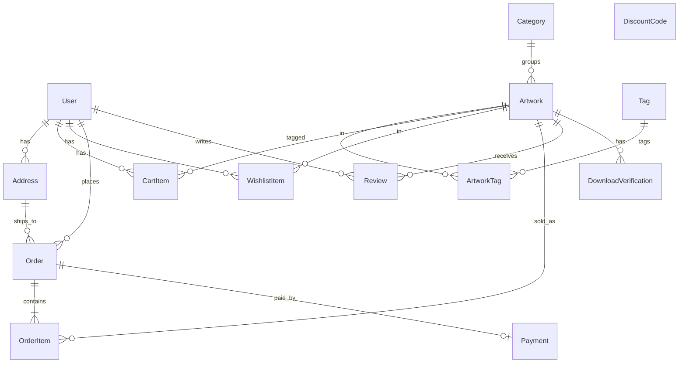
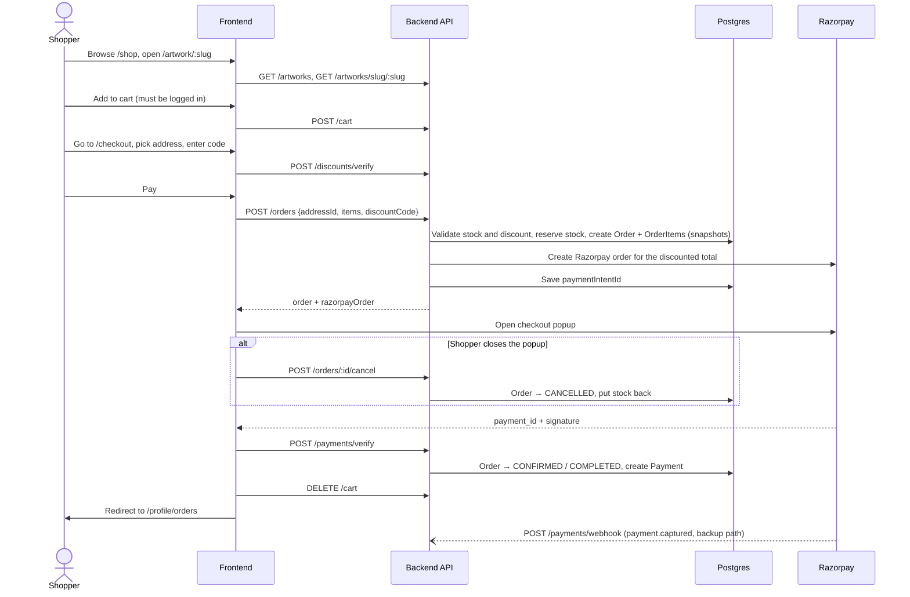

# Art Store

A full-stack e-commerce site for selling original artwork. Shoppers can browse and filter the catalogue, save favourites, manage a cart, and pay through Razorpay. The store owner gets an admin panel to manage artworks, the homepage, orders and discount codes, and see sales at a glance.

The data model also supports digital downloads, but they are switched off behind `DIGITAL_SALES_ENABLED` until downloads are built (issue #8), so only physical pieces are on sale.

Prices are in Indian Rupees and stored internally in **paise** (1 ₹ = 100 paise) to avoid floating-point rounding.

---

## Features

### For shoppers

- **Home page** — a hero showing three artworks (the admin's picks, filled with the newest pieces), a trust strip, a featured row of up to four artworks (the admin's order, in-stock first, or "Just added" when nothing is featured), and category tiles (empty categories hidden).
- **Shop** (`/shop`) — paginated catalogue with search, category filter, "specialty" tag filter, and sorting (newest, price low→high / high→low, most popular by views). The physical / digital type filter only shows when digital sales are on.
- **Collections** (`/collection`) — browse by category.
- **Artwork page** (`/artwork/:slug`) — image gallery, medium, dimensions, stock-aware quantity selector, "Sold Out" state (a made-to-order piece shows "Made to Order" instead, or how many ready copies are left), add to cart, and wishlist toggle. Specs with no value are hidden, and admins get an Edit link in the breadcrumb row.
- **Cart drawer** — slides in on add-to-cart; quantities are capped at available stock (no cap for made-to-order pieces), and each item links to its artwork page.
- **Wishlist** — heart any artwork; view it under your profile.
- **Checkout** (`/checkout`, login required) — pick a saved shipping address, apply a discount code (validated live and re-checked when the total changes), and pay via the Razorpay checkout popup. Items with more units than ready copies say how many will be made to order and that the store will be in touch about timing. Closing the popup cancels the unpaid order and puts its stock back.
- **Info pages** — About, Contact, FAQ, Shipping, Terms and Privacy (`/about`, `/contact`, `/faq`, `/shipping`, `/terms`, `/privacy`), linked from the footer. Shipping is within India only. The contact details in `frontend/src/utils/footerData.ts` are still placeholders.
- **Images** — Cloudinary photos are served resized for where they appear (thumbnail, card, full size), and a placeholder replaces any image that fails to load.
- **Profile** (`/profile`, login required) — personal info and password change, address book (with a default address), order history, order detail page, wishlist, and sign out.
- **Auth** (`/auth`) — email + password sign up / log in (JWT stored in `localStorage`).

### For the admin (`/admin`, `ADMIN` role only)

Admins see a Dashboard link in the navbar. When browsing the shop they also see drafts (customers don't); the homepage asks for published pieces only, so it looks the same for everyone.

- **Overview** — total artworks, revenue (from completed payments), customer count, active orders, and recent orders with status badges. Also:
  - **Hero picks** — choose the three artworks in the homepage hero (published pieces only); each change saves immediately.
  - **Featured order** — arrange the featured artworks with up/down arrows; this is the homepage's featured row order.
- **Artworks** — list with search, category and status (Published / Draft / Sold Out) filters (made-to-order pieces never count as sold out, and are marked in the Inventory column); quick publish/unpublish and feature toggles; soft delete.
- **Add / edit artwork** — name, slug, description, category, type, price, dimensions, medium, stock, featured / made-to-order / available flags, tags, and photos. Photos upload straight from the browser to Cloudinary (images up to 10 MB), or can be added by URL. `Ctrl+S` / `Cmd+S` saves the form.
- **Orders** — tabs for To Ship, In Transit, Delivered, Cancelled and All. Orders with made-to-order units carry a "Made to order" tag, so the owner knows to get in touch about timing. Mark an order shipped (with an optional tracking number), delivered, or cancelled (with an optional reason). Cancelling puts the stock back; refunds for paid orders are done by hand in the Razorpay dashboard.
- **Discounts** — create, edit, activate/deactivate, and delete discount codes (percentage or fixed amount, optional minimum spend, usage cap, and validity window).

---

## Tech stack

| Layer    | Tech                                                                     |
| -------- | ------------------------------------------------------------------------ |
| Frontend | React 19, TypeScript, Vite 7, React Router 7, Tailwind CSS 4, Axios, Zod |
| Backend  | Node.js, Express 5, TypeScript, Zod validation                           |
| Database | PostgreSQL via Prisma ORM 6                                              |
| Auth     | JWT (`jsonwebtoken`) + bcrypt password hashing                           |
| Payments | Razorpay (orders API, client checkout, signature verification, webhook)  |
| Images   | Cloudinary (signed direct uploads from the admin form, resized delivery) |

```
art-store/
├── backend/
│   ├── prisma/          # schema.prisma, migrations, seed.js
│   └── src/
│       ├── index.ts     # Express app + route mounting
│       ├── middleware.ts# auth / optionalAuth / admin guards
│       ├── lib/         # prisma + razorpay clients, zod schemas, config flags,
│       │                # discounts, payment confirmation, stock reservation
│       └── routes/      # one router per resource
└── frontend/
    └── src/
        ├── pages/       # route-level screens (incl. admin/ and profile/)
        ├── components/  # shop/, profile/, admin/, auth/, common/ (Select)
        ├── context/     # Auth, Cart, Wishlist, Toast providers
        ├── services/    # thin API wrappers over apiClient
        ├── layout/      # MainLayout, AdminLayout, Navbar, Footer
        ├── types/       # shared TS types
        └── theme.ts     # colour palette + spacing tokens
```

---

## Data model



| Model                    | Purpose and notable fields                                                                                                                                                                                                                                                                     |
| ------------------------ | ---------------------------------------------------------------------------------------------------------------------------------------------------------------------------------------------------------------------------------------------------------------------------------------------- |
| **User**                 | `role` is `ADMIN` or `CUSTOMER`. `isActive` supports self-deactivation / admin deactivation instead of hard delete.                                                                                                                                                                            |
| **Category**             | Name, unique slug, optional description and image. Every artwork belongs to exactly one category.                                                                                                                                                                                             |
| **Artwork**              | `type` is `PHYSICAL`, `DIGITAL`, or `BOTH`. `priceInPaise`, `stockQuantity`, `images[]` (URLs), `dimensions`, `medium`, `filePath` (for digital files). Flags: `isAvailable` (published vs draft), `isFeatured`, `isMadeToOrder`. `featuredPosition` = the admin's featured order (server-managed). `heroSlot` = homepage hero slot 1–3, unique, cleared on delete. `views` for popularity sort. `deletedAt` = soft delete. |
| **Tag / ArtworkTag**     | Many-to-many "specialties" (e.g. Abstract, Landscape) used by the shop filter.                                                                                                                                                                                                                 |
| **CartItem**             | One row per user + artwork (unique pair); adding again increments quantity.                                                                                                                                                                                                                    |
| **WishlistItem**         | One row per user + artwork.                                                                                                                                                                                                                                                                    |
| **Address**              | Saved shipping addresses; one can be `isDefault`. Country defaults to India.                                                                                                                                                                                                                   |
| **Order**                | `status` (`PENDING → CONFIRMED → SHIPPED → DELIVERED`, or `CANCELLED`) and `paymentStatus` (`PENDING / COMPLETED / FAILED / REFUNDED`). `paymentIntentId` holds the Razorpay order id. `totalPriceInPaise` is the amount actually charged, after any discount; `discountCode` and `discountInPaise` record the discount. Shipping address is **snapshotted** onto the order so later address edits don't rewrite history. |
| **OrderItem**            | Price, name, type, description and primary image **snapshotted at purchase time**, so editing or deleting an artwork doesn't change past orders. `madeToOrderQuantity` = how many units were ordered beyond the ready copies of a made-to-order piece.                                                                                                                                               |
| **Payment**              | One per order; stores the Razorpay payment id, amount and currency.                                                                                                                                                                                                                            |
| **Review**               | 1–5 rating + comment, one per user per artwork.                                                                                                                                                                                                                                                |
| **DiscountCode**         | `discountType` `PERCENTAGE` or `FIXED`; `discountValue` (percent or paise); optional `minPurchaseInPaise`, `maxUses`, `validFrom` / `validUntil`. Codes are stored uppercase. `usedCount` goes up when an order using the code is paid. |
| **DownloadVerification** | Expiring record tied to an artwork, intended for time-limited digital downloads (not wired up yet).                                                                                                                                                                                            |

---

## Key flows

### Browse → cart → checkout → payment



1. **Browsing** is public. Logged-out users only see `isAvailable` artworks; admins can also see drafts. While `DIGITAL_SALES_ENABLED` is off, `DIGITAL` artworks are hidden from everyone, admins included, in listings, artwork pages, cart, wishlist and orders (`BOTH` pieces stay on sale).
2. **Cart and wishlist** need an account. If a guest tries to add something, a toast asks them to log in.
3. **Placing an order** happens in one database transaction: reserve stock for `PHYSICAL` / `BOTH` items (the decrement only succeeds if enough stock is left), create the order and its line items, create the Razorpay order, and store its id. Made-to-order pieces (`isMadeToOrder`) can be ordered past their stock: the order takes whatever ready copies are left, stock stops at 0, and the rest are recorded as the line's `madeToOrderQuantity` (`takeReadyCopies` in `backend/src/lib/stock.ts`). Cancelling only returns the units that came from stock.
4. **Discounts** are applied by the server, which re-validates the code (active, dates, usage cap, minimum spend) and charges the discounted total; the frontend sends only the code. The charged amount must be at least ₹1. A code's `usedCount` goes up when the order is paid.
5. **Unpaid orders give their stock back** when the shopper closes the Razorpay popup (`POST /orders/:id/cancel`), when the admin cancels them, or, as a fallback, after 30 minutes (`RESERVATION_MINUTES` in `backend/src/lib/stock.ts`), checked on startup and every 5 minutes. The popup itself times out after 15 minutes.
6. **Payment confirmation** comes from two places: the browser calls `/payments/verify` with Razorpay's HMAC signature, and Razorpay's `payment.captured` webhook acts as a server-to-server backup. Both mark the order `CONFIRMED` + `COMPLETED` through one idempotent function, so whichever arrives second changes nothing. If a payment lands on an order that was already released, the order is revived and its stock taken again; for a made-to-order piece, copies sold in the meantime become made-to-order units instead of overselling. The webhook checks its signature against the raw request body, so it is mounted before the JSON parser.

### Auth

- `POST /auth/signup` and `POST /auth/login` return a JWT. The frontend keeps it in `localStorage` (`authToken`) and Axios sends it as `Authorization: Bearer …` on every request.
- On any `401` the client clears the token and redirects to `/auth`.
- `ProtectedRoute` guards `/checkout`, `/profile/*` (any logged-in user) and `/admin/*` (`ADMIN` only).
- Server middleware:
  - `authMiddleware`: token required.
  - `optionalAuthMiddleware`: attaches the user if a token is present, otherwise continues as a guest.
  - `adminMiddleware`: checks `role = ADMIN` in the database.

### Admin

The admin logs in with an `ADMIN` account, then works from `/admin`:

- Overview stats come from `GET /admin/stats` plus recent orders.
- Artworks use `POST`, `PATCH` and `DELETE` on `/artworks`. Delete is a soft delete that sets `deletedAt` and frees the artwork's hero slot. Featuring an artwork puts it at the front of the featured order.
- Hero picks save through `PUT /artworks/hero-slots` (three slots, no duplicates, published pieces only). The featured order saves through `PUT /artworks/featured-order`, which must list every featured artwork exactly once, or it returns `409`.
- Photo uploads ask `POST /uploads/signature` for a signed Cloudinary request, then upload straight from the browser to Cloudinary. The route returns `503` if the Cloudinary env vars aren't set.
- Order fulfilment uses `PATCH /orders/:id/status`. Allowed moves: `CONFIRMED → SHIPPED` (optional tracking number), `SHIPPED → DELIVERED`, and `PENDING` or `CONFIRMED → CANCELLED`. Anything else, or a status that changed meanwhile, returns `409`. Cancelling puts stock back; refunding a paid order is done by hand in the Razorpay dashboard.
- Discounts use `/discounts`. Shoppers can see active codes through `GET /discounts/public`.

---

## API reference

All routes are prefixed with `/api/v1` (except `GET /health`).

| Resource   | Public                                                         | Logged in                                                                                                 | Admin only                                                         |
| ---------- | -------------------------------------------------------------- | --------------------------------------------------------------------------------------------------------- | ------------------------------------------------------------------ |
| Auth       | `POST /auth/signup`, `POST /auth/login`                        |                                                                                                           |                                                                    |
| Users      |                                                                | `GET /users/me`, `PATCH /users/me`, `PATCH /users/me/password`, `PATCH /users/me/deactivate`, `PATCH /users/me/reactivate` | `GET /users`, `GET /users/:id`, `PATCH /users/:id/deactivate`      |
| Addresses  |                                                                | `GET /addresses`, `POST /addresses`, `PATCH /addresses/:id`, `DELETE /addresses/:id`                      |                                                                    |
| Categories | `GET /categories`                                              |                                                                                                           | `POST /categories`                                                 |
| Artworks   | `GET /artworks`, `GET /artworks/hero`, `GET /artworks/slug/:slug`, `GET /artworks/:id` |                                                                                 | `POST /artworks`, `PATCH /artworks/:id`, `DELETE /artworks/:id`, `PUT /artworks/hero-slots`, `PUT /artworks/featured-order` |
| Tags       | `GET /tags`                                                    |                                                                                                           | `POST /tags`, `DELETE /tags/:id`                                   |
| Cart       |                                                                | `GET /cart`, `POST /cart`, `PATCH /cart/:itemId`, `DELETE /cart/:itemId`, `DELETE /cart`                  |                                                                    |
| Wishlist   |                                                                | `GET /wishlist`, `POST /wishlist`, `DELETE /wishlist/:itemId`                                             |                                                                    |
| Orders     |                                                                | `GET /orders` (admins get all orders), `GET /orders/:id`, `POST /orders`, `POST /orders/:id/cancel` (own unpaid order) | `PATCH /orders/:id/status`                                         |
| Payments   | `POST /payments/verify`, `POST /payments/webhook`              |                                                                                                           |                                                                    |
| Reviews    | `GET /artworks/:id/reviews`                                    | `POST /artworks/:id/reviews`, `DELETE /artworks/:id/reviews/:reviewId`                                    |                                                                    |
| Discounts  | `GET /discounts/public`, `POST /discounts/verify`              |                                                                                                           | `GET /discounts`, `POST /discounts`, `PUT /discounts/:id`, `DELETE /discounts/:id` |
| Admin      |                                                                |                                                                                                           | `GET /admin/stats`                                                 |
| Uploads    |                                                                |                                                                                                           | `POST /uploads/signature`                                          |
| Health     | `GET /health`                                                  |                                                                                                           |                                                                    |

`GET /artworks` accepts `page`, `limit`, `search`, `categoryId`, `type`, `tag`, `isFeatured`, `isAvailable`, `sortBy` (`createdAt`, `price`, `views`, `name`, `featuredPosition`) and `sortOrder` (`asc`, `desc`). Guests and customers only ever see published artworks; admins also see drafts. `GET /artworks/hero` returns the admin's hero picks in slot order.

---

## Running locally

**Prerequisites:** Node 20+, pnpm, a PostgreSQL database, a Razorpay test account, and a Cloudinary account for photo uploads (optional; without it, add photos by URL).

### Backend

```bash
cd backend
cp .env.example .env      # fill in the values below
pnpm install
pnpm prisma migrate dev   # create tables
pnpm prisma db seed       # optional: sample data
pnpm dev                  # builds with tsc, then serves on PORT (default 8000)
```

| Variable               | Description                                                   |
| ---------------------- | ------------------------------------------------------------- |
| `DATABASE_URL`         | Postgres connection string. On Neon, use the pooled URL with `connect_timeout=15&pgbouncer=true` so requests wait out the database waking from idle instead of failing with P1001 (see `.env.example`) |
| `JWT_SECRET`           | Secret for signing auth tokens                                |
| `PORT`                 | API port (defaults to 8000)                                   |
| `RAZORPAY_TEST_KEY`    | Razorpay key id                                               |
| `RAZORPAY_TEST_SECRET` | Razorpay key secret (also used to verify webhook signatures)  |
| `DIGITAL_SALES_ENABLED` | `"true"` to sell `DIGITAL` artworks; keep `"false"` until downloads are built (issue #8) |
| `CLOUDINARY_CLOUD_NAME`, `CLOUDINARY_API_KEY`, `CLOUDINARY_API_SECRET` | Cloudinary credentials for admin photo uploads |

### Frontend

```bash
cd frontend
cp .env.example .env
pnpm install
pnpm dev                  # Vite dev server, usually http://localhost:5173
```

| Variable               | Description                                                     |
| ---------------------- | --------------------------------------------------------------- |
| `VITE_API_URL`         | Backend base URL, e.g. `http://localhost:8000/api/v1`           |
| `VITE_RAZORPAY_KEY_ID` | Razorpay **public** key id for the checkout popup |
| `VITE_DIGITAL_SALES_ENABLED` | Must match the backend's `DIGITAL_SALES_ENABLED`; shows the shop's physical / digital filter |

### Seed accounts

`prisma/seed.js` **wipes the database first**, then creates:

| Role     | Email                | Password      |
| -------- | -------------------- | ------------- |
| Admin    | `admin@artstore.com` | `password123` |
| Customer | `user@artstore.com`  | `password123` |

It also adds a sample address, categories, tags (Oil Painting, Abstract, Landscape, Portrait, Modern, Minimalist, Vintage, Cyberpunk) and sample artworks.

