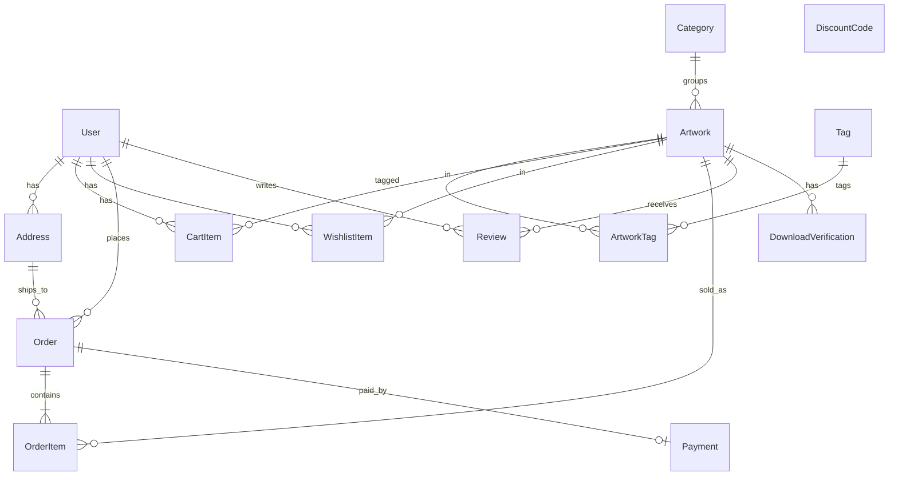
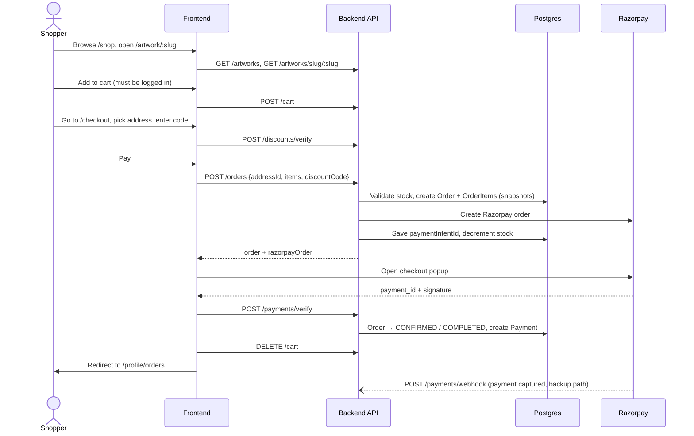

# Art Store

A full-stack e-commerce site for selling original artwork — physical pieces, digital downloads, or both. Shoppers can browse and filter the catalogue, save favourites, manage a cart, and pay through Razorpay. The store owner gets an admin panel to manage artworks, discount codes, and see sales at a glance.

Prices are in Indian Rupees and stored internally in **paise** (1 ₹ = 100 paise) to avoid floating-point rounding.

---

## Features

### For shoppers

- **Home page** — hero section and featured artworks (`isFeatured`).
- **Shop** (`/shop`) — paginated catalogue with search, category filter, "specialty" tag filter, type filter (physical / digital), and sorting (newest, price low→high / high→low, most popular by views).
- **Collections** (`/collection`) — browse by category.
- **Artwork page** (`/artwork/:slug`) — image gallery, medium, dimensions, made-to-order flag, stock-aware quantity selector, "Sold Out" state, add to cart, and wishlist toggle.
- **Cart drawer** — slides in on add-to-cart; quantities are capped at available stock.
- **Wishlist** — heart any artwork; view it under your profile.
- **Checkout** (`/checkout`, login required) — pick a saved shipping address, apply a discount code (validated live and re-checked when the total changes), and pay via the Razorpay checkout popup.
- **Profile** (`/profile`, login required) — personal info and password change, address book (with a default address), order history, order detail page, wishlist, and sign out.
- **Auth** (`/auth`) — email + password sign up / log in (JWT stored in `localStorage`).

### For the admin (`/admin`, `ADMIN` role only)

- **Overview** — total artworks, revenue (from completed payments), customer count, active orders, and recent orders with status badges.
- **Artworks** — list with category and status (Published / Draft / Sold Out) filters; quick publish/unpublish; soft delete.
- **Add / edit artwork** — name, slug, description, category, type, price, dimensions, medium, stock, featured / made-to-order / available flags, sort order, tags, and image URLs.
- **Discounts** — create, edit, activate/deactivate, and delete discount codes (percentage or fixed amount, optional minimum spend, usage cap, and validity window).

---

## Tech stack

| Layer    | Tech                                                                     |
| -------- | ------------------------------------------------------------------------ |
| Frontend | React 19, TypeScript, Vite 7, React Router 7, Tailwind CSS 4, Axios, Zod |
| Backend  | Node.js, Express 5, TypeScript, Zod validation                           |
| Database | PostgreSQL via Prisma ORM 6                                              |
| Auth     | JWT (`jsonwebtoken`) + bcrypt password hashing                           |
| Payments | Razorpay (orders API, client checkout, signature verification, webhook)  |

```
art-store/
├── backend/
│   ├── prisma/          # schema.prisma, migrations, seed.js
│   └── src/
│       ├── index.ts     # Express app + route mounting
│       ├── middleware.ts# auth / optionalAuth / admin guards
│       ├── lib/         # prisma client, razorpay client, zod schemas
│       └── routes/      # one router per resource
└── frontend/
    └── src/
        ├── pages/       # route-level screens (incl. admin/ and profile/)
        ├── components/  # shop/, profile/, admin/, auth/
        ├── context/     # Auth, Cart, Wishlist, Toast providers
        ├── services/    # thin API wrappers over apiClient
        ├── layout/      # MainLayout, AdminLayout, Navbar, Footer
        ├── types/       # shared TS types
        └── theme.ts     # colour palette + spacing tokens
```

---

## Data model



| Model                    | Purpose and notable fields                                                                                                                                                                                                                                                                     |
| ------------------------ | ---------------------------------------------------------------------------------------------------------------------------------------------------------------------------------------------------------------------------------------------------------------------------------------------- |
| **User**                 | `role` is `ADMIN` or `CUSTOMER`. `isActive` supports self-deactivation / admin deactivation instead of hard delete.                                                                                                                                                                            |
| **Category**             | Name, unique slug, optional description and image. Every artwork belongs to exactly one category.                                                                                                                                                                                             |
| **Artwork**              | `type` is `PHYSICAL`, `DIGITAL`, or `BOTH`. `priceInPaise`, `stockQuantity`, `images[]` (URLs), `dimensions`, `medium`, `filePath` (for digital files). Flags: `isAvailable` (published vs draft), `isFeatured`, `isMadeToOrder`. `views` for popularity sort. `deletedAt` = soft delete. |
| **Tag / ArtworkTag**     | Many-to-many "specialties" (e.g. Abstract, Landscape) used by the shop filter.                                                                                                                                                                                                                 |
| **CartItem**             | One row per user + artwork (unique pair); adding again increments quantity.                                                                                                                                                                                                                    |
| **WishlistItem**         | One row per user + artwork.                                                                                                                                                                                                                                                                    |
| **Address**              | Saved shipping addresses; one can be `isDefault`. Country defaults to India.                                                                                                                                                                                                                   |
| **Order**                | `status` (`PENDING → CONFIRMED → SHIPPED → DELIVERED`, or `CANCELLED`) and `paymentStatus` (`PENDING / COMPLETED / FAILED / REFUNDED`). `paymentIntentId` holds the Razorpay order id. Shipping address is **snapshotted** onto the order so later address edits don't rewrite history.       |
| **OrderItem**            | Price, name, type, description and primary image **snapshotted at purchase time**, so editing or deleting an artwork doesn't change past orders.                                                                                                                                               |
| **Payment**              | One per order; stores the Razorpay payment id, amount and currency.                                                                                                                                                                                                                            |
| **Review**               | 1–5 rating + comment, one per user per artwork.                                                                                                                                                                                                                                                |
| **DiscountCode**         | `discountType` `PERCENTAGE` or `FIXED`; `discountValue` (percent or paise); optional `minPurchaseInPaise`, `maxUses`, `validFrom` / `validUntil`. Codes are stored uppercase.                                                                                                                  |
| **DownloadVerification** | Expiring record tied to an artwork, intended for time-limited digital downloads (not wired up yet).                                                                                                                                                                                            |

---

## Key flows

### Browse → cart → checkout → payment



1. **Browsing** is public. Logged-out users only see `isAvailable` artworks; admins can also see drafts.
2. **Cart and wishlist** need an account. If a guest tries to add something, a toast asks them to log in.
3. **Placing an order** happens in one database transaction: create the order and its line items, create the Razorpay order, store its id, and decrement stock for `PHYSICAL` / `BOTH` items.
4. **Payment confirmation** comes from two places: the browser calls `/payments/verify` with Razorpay's HMAC signature, and Razorpay's `payment.captured` webhook acts as a server-to-server backup. Both mark the order `CONFIRMED` + `COMPLETED`.

### Auth

- `POST /auth/signup` and `POST /auth/login` return a JWT. The frontend keeps it in `localStorage` (`authToken`) and Axios sends it as `Authorization: Bearer …` on every request.
- On any `401` the client clears the token and redirects to `/auth`.
- `ProtectedRoute` guards `/checkout`, `/profile/*` (any logged-in user) and `/admin/*` (`ADMIN` only).
- Server middleware:
  - `authMiddleware`: token required.
  - `optionalAuthMiddleware`: attaches the user if a token is present, otherwise continues as a guest.
  - `adminMiddleware`: checks `role = ADMIN` in the database.

### Admin

The admin logs in with an `ADMIN` account, then works from `/admin`:

- Overview stats come from `GET /admin/stats` plus recent orders.
- Artworks use `POST`, `PATCH` and `DELETE` on `/artworks`. Delete is a soft delete that sets `deletedAt`.
- Discounts use `/discounts`. Shoppers can see active codes through `GET /discounts/public`.

---

## API reference

All routes are prefixed with `/api/v1` (except `GET /health`).

| Resource   | Public                                                         | Logged in                                                                                                 | Admin only                                                         |
| ---------- | -------------------------------------------------------------- | --------------------------------------------------------------------------------------------------------- | ------------------------------------------------------------------ |
| Auth       | `POST /auth/signup`, `POST /auth/login`                        |                                                                                                           |                                                                    |
| Users      |                                                                | `GET /users/me`, `PATCH /users/me`, `PATCH /users/me/password`, `PATCH /users/me/deactivate`, `PATCH /users/me/reactivate` | `GET /users`, `GET /users/:id`, `PATCH /users/:id/deactivate`      |
| Addresses  |                                                                | `GET /addresses`, `POST /addresses`, `PATCH /addresses/:id`, `DELETE /addresses/:id`                      |                                                                    |
| Categories | `GET /categories`                                              |                                                                                                           | `POST /categories`                                                 |
| Artworks   | `GET /artworks`, `GET /artworks/slug/:slug`, `GET /artworks/:id` |                                                                                                         | `POST /artworks`, `PATCH /artworks/:id`, `DELETE /artworks/:id`    |
| Tags       | `GET /tags`                                                    |                                                                                                           | `POST /tags`, `DELETE /tags/:id`                                   |
| Cart       |                                                                | `GET /cart`, `POST /cart`, `PATCH /cart/:itemId`, `DELETE /cart/:itemId`, `DELETE /cart`                  |                                                                    |
| Wishlist   |                                                                | `GET /wishlist`, `POST /wishlist`, `DELETE /wishlist/:itemId`                                             |                                                                    |
| Orders     |                                                                | `GET /orders` (admins get all orders), `GET /orders/:id`, `POST /orders`                                  |                                                                    |
| Payments   | `POST /payments/verify`, `POST /payments/webhook`              |                                                                                                           |                                                                    |
| Reviews    | `GET /artworks/:id/reviews`                                    | `POST /artworks/:id/reviews`, `DELETE /artworks/:id/reviews/:reviewId`                                    |                                                                    |
| Discounts  | `GET /discounts/public`, `POST /discounts/verify`              |                                                                                                           | `GET /discounts`, `POST /discounts`, `PUT /discounts/:id`, `DELETE /discounts/:id` |
| Admin      |                                                                |                                                                                                           | `GET /admin/stats`                                                 |
| Health     | `GET /health`                                                  |                                                                                                           |                                                                    |

`GET /artworks` accepts `page`, `limit`, `search`, `categoryId`, `type`, `tag`, `isFeatured`, `isAvailable`, `sortBy` (`createdAt`, `price`, `views`, `name`) and `sortOrder` (`asc`, `desc`). Guests and customers only ever see published artworks; admins also see drafts.

---

## Running locally

**Prerequisites:** Node 20+, pnpm, a PostgreSQL database, and a Razorpay test account.

### Backend

```bash
cd backend
cp .env.example .env      # fill in the values below
pnpm install
pnpm prisma migrate dev   # create tables
pnpm prisma db seed       # optional: sample data
pnpm dev                  # builds with tsc, then serves on PORT (default 8000)
```

| Variable               | Description                                                   |
| ---------------------- | ------------------------------------------------------------- |
| `DATABASE_URL`         | Postgres connection string                                    |
| `JWT_SECRET`           | Secret for signing auth tokens                                |
| `PORT`                 | API port (defaults to 8000)                                   |
| `RAZORPAY_TEST_KEY`    | Razorpay key id                                               |
| `RAZORPAY_TEST_SECRET` | Razorpay key secret (also used to verify webhook signatures)  |

### Frontend

```bash
cd frontend
cp .env.example .env
pnpm install
pnpm dev                  # Vite dev server, usually http://localhost:5173
```

| Variable               | Description                                                     |
| ---------------------- | --------------------------------------------------------------- |
| `VITE_API_URL`         | Backend base URL, e.g. `http://localhost:8000/api/v1`           |
| `VITE_RAZORPAY_KEY_ID` | Razorpay **public** key id for the checkout popup |

### Seed accounts

`prisma/seed.js` **wipes the database first**, then creates:

| Role     | Email                | Password      |
| -------- | -------------------- | ------------- |
| Admin    | `admin@artstore.com` | `password123` |
| Customer | `user@artstore.com`  | `password123` |

It also adds a sample address, categories, tags (Oil Painting, Abstract, Landscape, Portrait, Modern, Minimalist, Vintage, Cyberpunk) and sample artworks.

